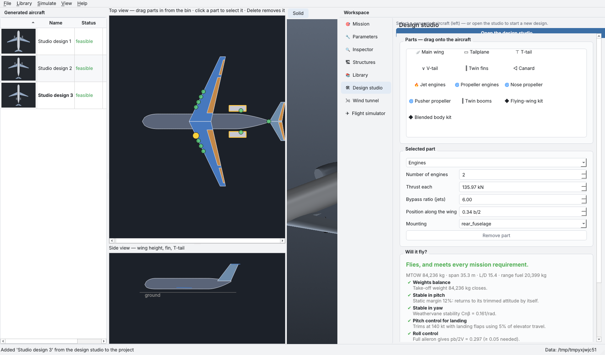

# Design studio and wind tunnel

## Design studio (Kerbal-style) — 🛠 Design studio page

**Build by dragging parts.** Drag a part from the **Parts** bin into the top
view or the side view. While you drag, every place that part can attach
lights up as a **green node**, and the nearest one turns yellow. Drop it to
attach the part there.

| Part | Where it attaches |
|---|---|
| Main wing | along the fuselage (top view) or low / mid / high (side view) |
| Tailplane, T-tail, V-tail, twin fins | the tail (T-tail also on the fin tip in the side view) |
| Canard | near the nose (the wing moves aft) |
| Jet engines | under the wing (inboard or outboard; a second pair makes four), the rear fuselage, on top (side view) or the tail cone |
| Propeller engines | the wing |
| Nose propeller | the nose |
| Pusher propeller | the tail cone |
| Twin booms | the wing |
| Flying-wing kit, blended-body kit | anywhere: converts the whole aircraft |

**Select a part** by clicking it, or pick it from the list. It is outlined
in gold, and only its drag handles appear:

* ◆ moves it;
* ● at a tip sets span and sweep;
* ■ sets chords and taper;
* orange handles set control-surface edges and chord.

**The properties panel** shows every dimension of the selected part, and:

* **Strength**, for the wing, tails, fuselage and landing gear: a material
  plus a **reserve factor** (1 means sized exactly to the design ultimate
  load; 2 means twice as strong). It reads out the g at which the part
  breaks and what it weighs. The *Whole aircraft* entry holds the **g
  rating** and the safety factor.
* **Remove part** (or the Delete key) works where the result is still an
  aircraft: removing the tail makes a flying wing, removing the canard or
  booms makes a conventional layout. The wing, fuselage, engines and gear
  can be reshaped but not removed.

**Which plane you're editing.** The studio, wind tunnel and flight simulator
always show the plane selected in the left panel; the page title names it.
Choose another plane and the page switches to it.

* **Apply changes to '<plane>'** saves your edits into that plane.
* **Save as new plane** keeps the original and adds your version beside it.
* If you switch planes with unapplied changes, you are asked whether to apply
  or discard them.

**Will it fly?** updates as you build. **⚖ Balance** moves the wing to
restore pitch stability after you move heavy parts, for example rear
engines. **✈ Fly it** and **🌬 Wind tunnel** open those pages with the
studio's current design, even before you apply it. It is shown as
"<plane> (studio)" until you pick a plane again.

## Wind tunnel — 🌬 Wind tunnel page

The design sits in a flow computed by a **vortex-lattice method**
(`numerics/vlm.py`):

* Every lifting surface is divided into horseshoe vortices on its true camber
  surface, including sweep, dihedral, twist and cranks.
* Control deflections tilt the panels aft of the hinge.
* A source line along the fuselage displaces the flow around the body.

**Validated:**

* lift slope within the expected range of lifting-surface theory, with span
  efficiency of about 0.98;
* correct signs for elevator, aileron and sideslip;
* stability that agrees in sign with the evaluator;
* downwash behind the wing and swirl around the wing-tip vortices.

**What you see:**

* **Streamlines** traced through the computed 3-D velocity field (blue =
  slower, red = faster), with **animated smoke**. A ring of seeds around each
  tip shows the tip vortex winding up.
* **Surface colours**, either:
  * *lifting pressure (ΔCp)*: where the lift is generated; or
  * *structural stress at any load factor*: the sized wing box's
    ultimate-load margins scaled to the chosen g and the wing's strength
    reserve. Magenta means that part has failed.
* **Readouts:**
  * CL, induced drag, Cm and side force;
  * lift in kN compared with the take-off weight;
  * span efficiency and lift slope;
  * static margin compared with the evaluator;
  * a stall warning when CL exceeds the wing's CLmax;
  * the load factor at which the wing box first fails;
  * a spanwise lift plot against the ideal elliptic distribution.

**Limits:**

* inviscid, attached flow: no stall, separation or viscous drag;
* a fixed flat wake, which overstates the canard-wake effect on the wing;
* the fuselage moment uses the evaluator's statistical (Raymer) term.
