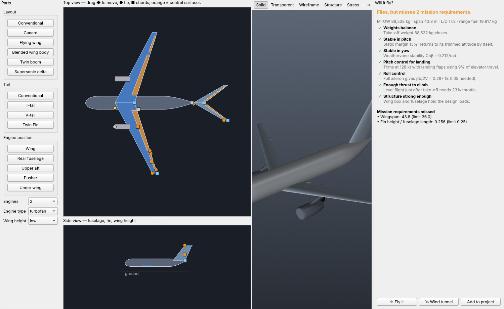
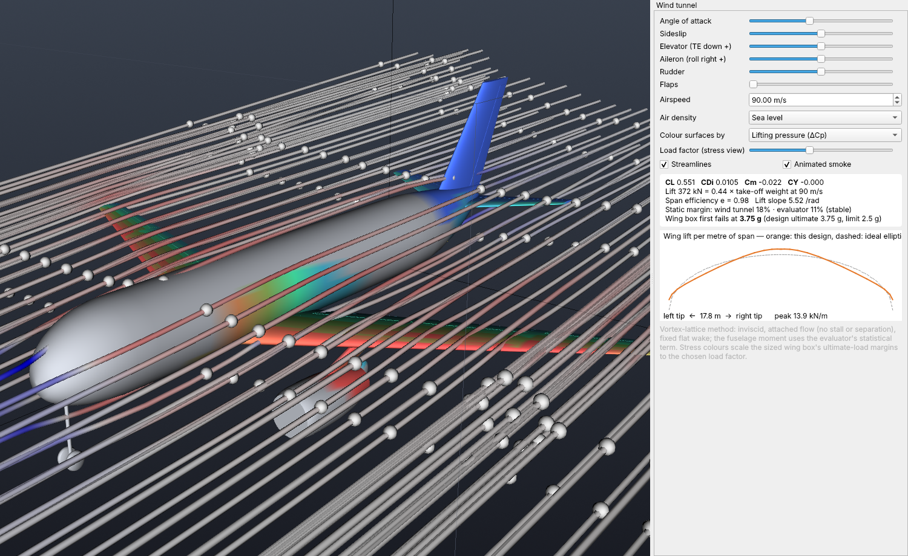

# Design studio and wind tunnel

## Design studio (🛠 Studio, F6)

Build or reshape an aircraft by dragging, then find out whether it flies.

**Parts palette (left)**

* **Layout:** conventional, canard, flying wing, blended wing body, twin boom
  or supersonic delta. Choosing one sizes a fresh starting design for your
  mission.
* **Tail:** conventional, T-tail, V-tail or twin fins.
* **Engine position:** on the wing, rear fuselage, upper aft, pusher or under
  the wing.
* **Engine settings:** count (1 to 4), type (jet or propeller) and wing
  height.

Each choice re-sizes the tails and finishes the design (gear, structure) so
that it stays consistent.

**Top and side views (drag the handles)**

| Handle | Edits |
|---|---|
| ◆ yellow | moves a wing, tail or canard along the fuselage |
| ● orange at a tip | span and sweep |
| ■ blue | root chord (at the root trailing edge) and taper (at the tip trailing edge) |
| grey ■ | fuselage length and diameter |
| grey ● | slides the engines along the wing |
| orange (control surfaces) | aileron inner and outer edges and chord, flap span and chord, rudder chord (side view) |
| side view ● / ■ | fin height and sweep, fin chord |

Every handle edits a real design parameter, clamped to its valid range. So
whatever you build stays a consistent aircraft that the evaluator,
structures, flight model and wind tunnel can all analyse.

**Will it fly? (right)**

The verdict updates as you drag. It asks two separate questions.

*Can it fly at all?*

* Do the weights close?
* Is it stable in pitch (static margin), or flyable only with fly-by-wire?
* Is it stable in yaw, or flyable with yaw augmentation (like the B-2)?
* Can the elevator trim it at landing speed with full flaps?
* Is roll control enough (pb/2V ≥ 0.05)?
* Is there enough thrust to climb?
* Is the structure strong enough?

*Does it meet the mission?* Every evaluator requirement it misses is listed.

**Buttons**

* **✈ Fly it** opens the simulator (only when the aircraft can fly).
* **🌬 Wind tunnel** opens the wind tunnel.
* **Add to project** adds the design to the gallery.

## Wind tunnel (🌬 Wind tunnel, F7)

The design sits in a flow computed by a **vortex-lattice method**
(`numerics/vlm.py`):

* Every lifting surface is divided into horseshoe vortices on its true camber
  surface, including sweep, dihedral, twist and cranks.
* Control deflections tilt the panels aft of the hinge.
* A source line along the fuselage displaces the flow around the body.

**Validated:**

* lift slope within the expected range of lifting-surface theory, with span
  efficiency of about 0.98;
* correct signs for elevator, aileron and sideslip;
* stability that agrees in sign with the evaluator;
* downwash behind the wing and swirl around the wing-tip vortices.

**What you see:**

* **Streamlines** traced through the computed 3-D velocity field (blue =
  slower, red = faster), with **animated smoke**. A ring of seeds around each
  tip shows the tip vortex winding up.
* **Surface colours**, either:
  * *lifting pressure (ΔCp)*: where the lift is generated; or
  * *structural stress at any load factor*: the sized wing box's
    ultimate-load margins scaled to the chosen g. Magenta means that part
    has failed.
* **Readouts:**
  * CL, induced drag, Cm and side force;
  * lift in kN compared with the take-off weight;
  * span efficiency and lift slope;
  * static margin compared with the evaluator;
  * a stall warning when CL exceeds the wing's CLmax;
  * the load factor at which the wing box first fails;
  * a spanwise lift plot against the ideal elliptic distribution.

**Limits:**

* inviscid, attached flow: no stall, separation or viscous drag;
* a fixed flat wake, which overstates the canard-wake effect on the wing;
* the fuselage moment uses the evaluator's statistical (Raymer) term.
