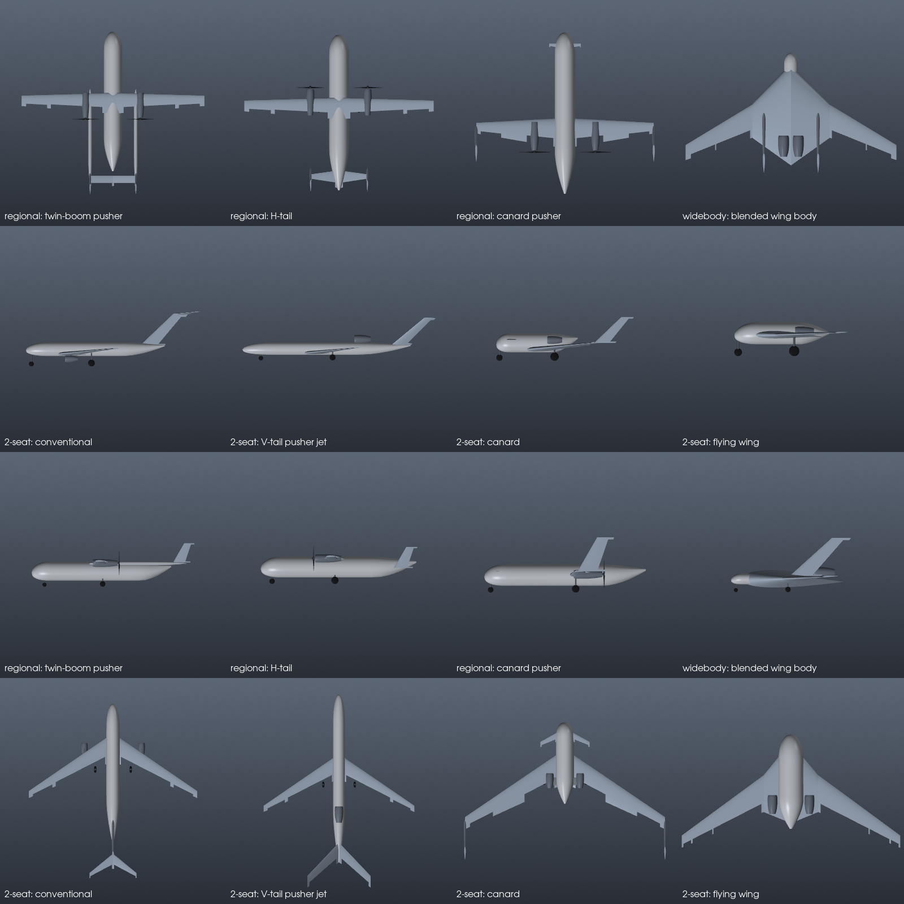

# Aircraft layouts

The generator sizes every layout that suits the mission and holds each
topology fixed during evolution. Choose **Mission ▸ Layouts to explore**
(all suitable / conventional only / unconventional only) to steer the
search.

| Layout | Offered when | What changes in the model |
|---|---|---|
| Conventional: tail, T-tail | always | Fuselage stretched for a tail arm of 3.5 × MAC (jets) or 2.8 × MAC (props) |
| Conventional: V-tail | jets, payload ≤ 3 t (pusher jet on top of the rear fuselage) | Purser–Campbell sizing: area = S_h + S_v, cant angle Γ = atan √(S_v/S_h); pitch uses cos²Γ, yaw uses sin²Γ; ruddervators |
| Conventional: H-tail (twin fins) | turboprops, payload ≤ 3 t | Fins on the tailplane tips, each sized for half the yaw volume |
| Canard | jets ≤ 8 t, turboprops ≤ 4 t | Foreplane sits in the wing's *upwash*; wing moved aft and placed for static margin; flaps limited (they would upset trim); wing-tip fins |
| Flying wing | jets, payload ≤ 12 t | Cranked planform, no tail. Stability comes from sweep, washout and forward fuel. Elevons; split drag rudders and a stated need for active yaw control. No flaps, hence lower CLmax |
| Blended wing body | jets, payload ≥ 10 t | Passenger cabin inside the thick centre-body. The centre-body chord is solved so that the floor area at ≥ 2.1 m standing height fits the passengers. Non-circular pressure-shell weight penalty. Twin fins |
| Twin-boom | turboprops, payload ≤ 6 t | Booms from the wing to a tailplane spanning between them. Boom spacing clears the pusher propeller. Tail placed behind the pod |

Pusher turboprops in pairs sit on the wing trailing edge (Piaggio Avanti /
Beech Starship style). A single pusher turboprop sits in the tail cone, with
its propeller behind.

## Results the physics reproduces

These are checked by tests in `tests/test_layouts.py`.

* **Long-range two-seater at Mach 0.85:** the flying wing needs about half the
  fuel of a conventional jet. With almost no payload to house, losing the
  tail and fuselage pays.
* **Blended wing bodies only win at large size.** At 160 seats the 2.1 m
  cabin height forces a huge, low-aspect-ratio centre-body, and the BWB burns
  *more* than a tube-and-wing. At widebody size it is lighter and burns less
  per passenger-km. This is the published BWB trend.
* **Tail proportions:** fin height ≤ 25 % of fuselage length, and tail area
  ≤ 40 % of wing area. Tail sizing now lengthens the fuselage instead of
  growing a giant tail on a short cabin.

## Simplifications to be aware of

* Tailless pitch trim uses sweep, washout and fuel placement. Reflex camber
  and trim-drag polars are not modelled.
* The BWB centre-body weight is an equivalent-tube penalty (+15 %), not a
  finite-element pressure-shell analysis.
* Booms are not structurally analysed: they carry a statistical areal weight.
* Supersonic flight is not modelled: cruise Mach is limited to 0.86.
