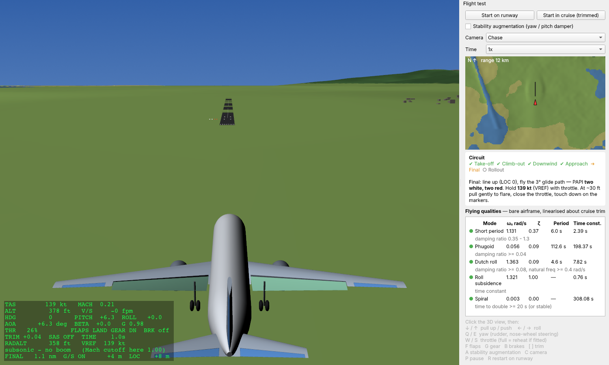
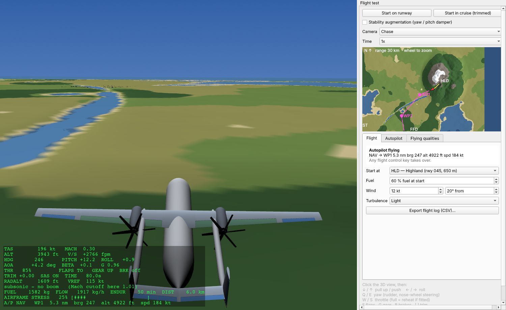
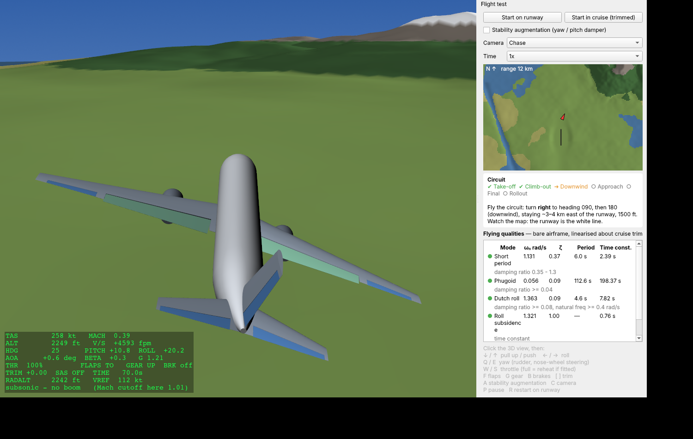
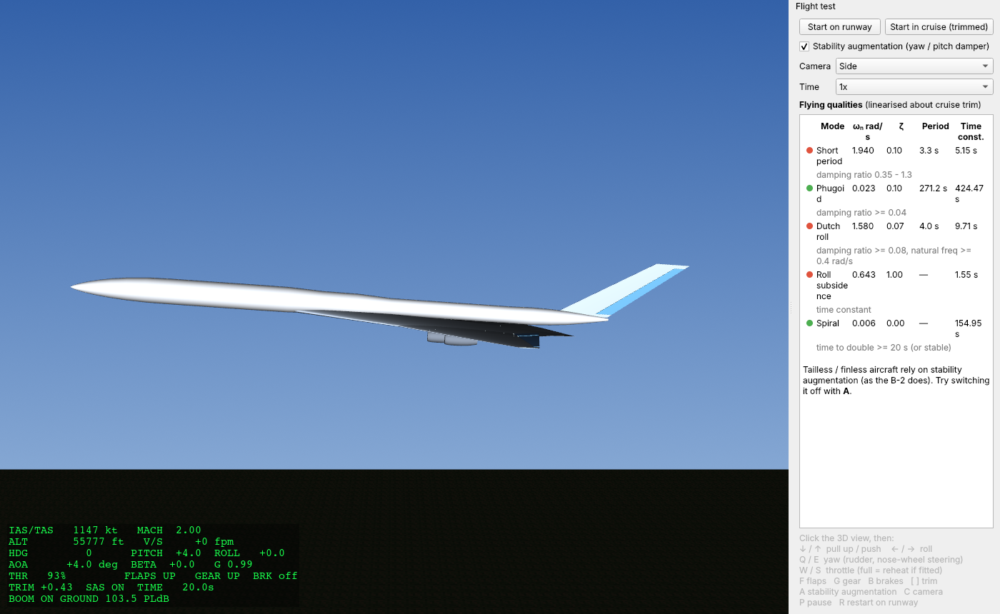

# Flight-test simulator

Select a design and press **✈ Fly** (or Simulate ▸ Fly, F5). The aircraft
you generated flies in 3D over terrain with a runway, and its control
surfaces move about their real hinge lines.

## Fly a circuit by hand: take off, fly around, land

Press **✈ Fly**. You start lined up on the runway, and the **Circuit** coach
in the side panel walks you through each phase:

1. **Take-off.** Release the brakes (B) and apply full throttle (hold W).
   Keep straight with Q/E. At the rotation speed shown, pull back (hold ↓)
   to about 8–10° nose-up.
2. **Climb-out.** Raise the gear (G) and the flaps (F) and level off at
   about 1,500 ft on the RADALT (height above ground).
3. **Downwind.** Turn right onto heading 090, then 180, about 3–4 km east of
   the runway. Use the moving map to see where you are.
4. **Approach.** Descend, and turn right onto final heading 360 about
   8–10 km south of the runway. Gear down, landing flaps.
5. **Final.** Line up so the LOC reading is 0. Fly the 3° glide path, which
   the **PAPI** lights beside the runway show as two white and two red. Hold
   **VREF** (shown on the HUD) with the throttle. Flare from about 30 ft and
   close the throttle.
6. **Rollout.** Brakes on and keep straight until you stop.

The landing is then **rated**:

* touchdown sink rate (smooth / good / firm / hard);
* touchdown point (ideally 300–600 m past the threshold);
* centreline offset;
* whether you stopped on the runway.

**Start in cruise** skips straight to flying around.

**Landing aids:**

* the PAPI (white over red = on slope, all white = too high, all red = too
  low);
* runway edge lights, threshold and touchdown-zone markings;
* on the HUD: RADALT, VREF and, on final, the distance to go plus glide-slope
  and centreline deviation;
* warnings: TERRAIN – PULL UP, TOO LOW – GEAR, SINK RATE, STALL.

The test suite proves every layout is landable. A scripted test pilot flies
the approach and lands the A320-class jet, a twin-boom turboprop and a
flying wing, each at about 1.1–1.2 m/s sink, on the centreline.

## Autopilot (0.5)

Open the **Autopilot** tab and choose a program:

| Program | What it does |
|---|---|
| Hold | Keeps the current altitude, heading and speed. |
| Take off, fly a circuit, land | Fully automatic, from the runway to a full stop. |
| Continuous circuits | Flies touch-and-go laps until the fuel reaches the reserve you set, then lands. The **lap log** records time, fuel used, fuel left, distance and how steadily height was held. Use it to test range and how the aircraft behaves as it gets light. |
| Fly flight plan | Tick *Click map to add* and click waypoints on the map (each gets the altitude and speed shown). The autopilot takes off, flies the route, then makes an approach and lands at the chosen destination. |
| Land now | From the air, goes to the destination's final approach fix and lands. |

**How it works.** It is built like a real autopilot:

* inner pitch and roll loops, with rate damping and automatic trim;
* outer loops for altitude, flight path, heading, waypoints and the
  localizer, plus a 3° glide slope captured from below, as on a real ILS;
* an auto-throttle.

It also has the protections a real one needs:

* stall protection (angle of attack held to 85% of the stall angle, plus
  full power);
* energy management, so it never climbs at idle power;
* terrain awareness, keeping at least 300 m clear of the ground ahead.

**Taking over.** Any flight-control key disconnects the autopilot, just as
in a real aircraft.

**Tested landings.** It lands the A320-class jet, the flying wing and the
twin-boom turboprop with scores of about 74–92/100.

## Fuel, structure and weather (0.5)

* **Fuel** burns according to thrust and engine efficiency (doubled in
  reheat). The aircraft gets lighter as it burns, and the engines flame out
  at empty. Set the starting fuel on the *Flight* tab. The HUD shows fuel,
  fuel flow, endurance and distance flown.
* **Airframe stress** is shown live on the HUD:
  * Wing-root bending on each side comes from the load factor plus the
    aileron rolling moment. A rolling pull-up overloads one wing.
  * Exceeding the ultimate load (limit × safety factor), in positive or
    negative g, breaks a wing. It falls away as debris and the aircraft
    spirals in.
  * Flying more than about 10% past the design dive speed causes tail
    flutter failure.
  * Below manoeuvring speed the wing stalls before it can break, as on a
    real aircraft.
* **Weather:** wind speed and direction, plus light, moderate or severe
  turbulence.
* **Flight log:** telemetry is recorded twice a second (position, altitude,
  speeds, attitude, g, fuel, stress, autopilot mode). Export it as CSV from
  the *Flight* tab.

## Terrain

The landscape is 120 km × 120 km, generated procedurally (no download
needed), and it is solid: wheels roll on it, and flying into a hill is a
crash. It has four airports:

| Code | Airport | Runway heading | Elevation | Notes |
|---|---|---|---|---|
| FFD | Foundry Field | 360 | sea level | home base |
| LKS | Lakeside | 090 | sea level | beside a lake |
| CST | Coastal | 180 | sea level | by the sea |
| HLD | Highland | 045 | 650 m | one-way mountain strip: land uphill, take off down the valley |

Pick the starting airport on the *Flight* tab. The approach and PAPI
guidance work for whichever runway you are heading to.

* the airfield on level ground, with a 3.5 km runway heading 360;
* farmland and rolling hills, kept low along the approach;
* a mountain range to the north-east, with peaks to about 1,500 m and snow;
* a lake and river valley to the south-west;
* a town just east of the airfield.

## Flight model (`simulator/flightmodel.py`)

This is a six-degree-of-freedom rigid-body model, integrated with RK4 at
200 Hz. It runs faster than real time.

Everything comes from the design itself:

* **Mass, CG and inertia:** evaluated weights, plus Roskam radii of gyration.
* **Lift and pitch:** lift slope from the wing and every pitch surface (with
  downwash for tails, upwash for canards); pitch stiffness from the computed
  static margin. The aerodynamic centre shifts aft at supersonic speed.
* **Control power:** from the actual control-surface spans and chords
  (flap-effectiveness theory) for elevators, canards, elevons, ruddervators,
  ailerons, rudders and split drag rudders.
* **Directional and damping terms:** weathervane stability, roll and yaw
  damping from fins, V-tails and the fuselage (Munk moment); dihedral effect
  from dihedral and sweep.
* **Drag:** the evaluator's drag polar, including transonic and supersonic
  wave drag.
* **Thrust:** lapses with altitude and Mach; reheat at full throttle on
  low-bypass engines.
* **Landing gear:** the real gear positions as spring–damper wheels, with
  rolling and braking friction and nose-wheel steering.
* **Hazards:** a stall model, plus crash detection for hard landings and wing
  or tail strikes.

**Stability augmentation** follows fly-by-wire practice:

* yaw-rate damping around the coordinated-turn rate;
* sideslip feedback;
* a pitch damper.

It is on by default for tailless and finless designs. A finless flying wing
*departs* without it and flies normally with it, which is the real B-2 story.

## Flying qualities

The panel shows the bare-airframe modes, linearised about cruise trim and
checked against MIL-F-8785C level-1 limits:

* short period;
* phugoid;
* Dutch roll;
* roll subsidence;
* spiral.

The A320-class design gives typical airliner values:

| Mode | Model value | Level-1 check |
|---|---|---|
| Short period | ωn ≈ 1.1, ζ ≈ 0.37 | ✓ |
| Phugoid | ≈ 110 s period | ✓ |
| Dutch roll | ωn ≈ 1.4, ζ ≈ 0.09 | ✓ |
| Roll subsidence | τ ≈ 0.8 s | ✓ |

The Concorde-class delta shows the poorly damped short period and Dutch
roll of real slender deltas, which flew with autostabilisation.

## Controls

Click the 3D view first.

| Key | Action |
|---|---|
| ↓ / ↑ | pull up / push |
| ← / → | roll |
| Q / E | rudder (nose-wheel steering on the ground) |
| W / S | throttle (full throttle = reheat where fitted) |
| F | flaps (up / take-off / landing) |
| G | gear |
| B | brakes |
| [ / ] | pitch trim |
| A | stability augmentation |
| C | camera (chase / side / tower / cockpit) |
| P | pause |
| R | restart on the runway (new circuit) |

**Start in cruise** begins trimmed at the design cruise condition.

## Limits

Conceptual-design fidelity:

* linear aerodynamics with a simple stall;
* no ground effect;
* no engine spool-up dynamics;
* no aeroelasticity;
* no weather or wind;
* no reverse thrust or spoilers (stop with the brakes);
* keyboard only (no joystick support yet).
